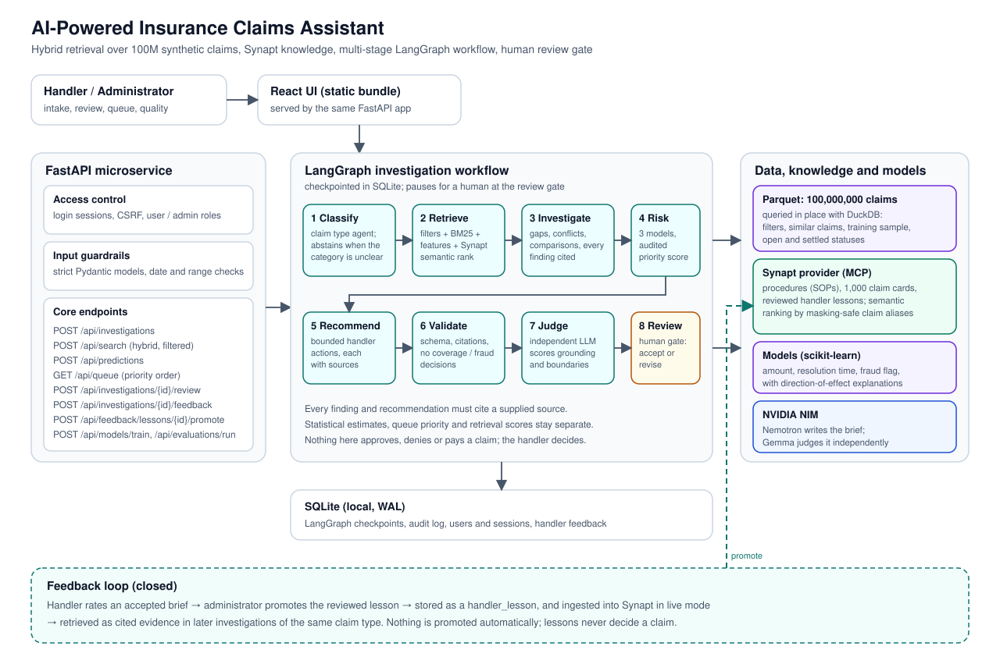

# Architecture and design

The diagram source is [architecture.svg](architecture.svg) (a PNG render is in
[architecture.png](architecture.png)). This document explains the design behind it.

## Components

| Component | Responsibility | Code |
|---|---|---|
| FastAPI service | Authentication, CSRF, roles, strict input validation, the HTTP API, and serving the compiled UI | `api/main.py`, `api/auth.py`, `core/schemas.py` |
| LangGraph workflow | The ordered, checkpointed investigation with a human review gate | `investigation/workflow.py` |
| Agents | Classification, investigation and recommendation (live: NVIDIA Nemotron; fixture: deterministic rules) | `agents/stage_agents.py`, `llm/client.py` |
| Historical data | The 100M-row Parquet file queried in place by DuckDB | `history/dataset.py` |
| Retriever | Exact filters, candidate generation, fusion of keyword, numeric and Synapt semantic ranks | `history/retriever.py`, `corpus/cards.py` |
| Synapt adapter | MCP client: login, tool discovery, retrieval, ingestion; fail-closed and read-only by default | `synapt/adapter.py` |
| Models | Amount, resolution time and fraud-flag models with explanations | `ml/analytics.py` |
| Priority | Transparent 0 to 100 score and tier | `investigation/priority.py` |
| Judge | An independent model's verdict on each live brief | `evaluation/judge.py` |
| Evaluation | Golden cases and DeepEval | `evaluation/service.py` |
| Feedback | Reviewed lessons, promotion, reuse as evidence | `corpus/lessons.py`, `storage/run_store.py` |
| Store | SQLite: runs, audit log, feedback, spans, request log; separate connection for LangGraph checkpoints | `storage/run_store.py` |
| Telemetry | Spans for every stage, model call, retrieval and scoring step; reconstruction for older runs | `observability/telemetry.py` |
| Observability | Per-run traces and system-wide metrics from spans, reconstructed spans and the request log | `observability/observatory.py` |
| Explain | How a saved brief was generated and evaluated, written for the caller's role | `observability/explain.py` |

## Backend layout

`src/claims/` is split into packages by the work each part does. A package's `__init__.py` holds a one-line
description and imports nothing from the package, so importing one module never loads the rest. The Code column above
and every path in these docs are relative to `src/claims/`.

| Package | The work it does | Modules (former name where it changed) |
|---|---|---|
| `core/` | Configuration and the claim vocabulary every other package shares | `settings.py`, `schemas.py` (`models.py`), `demo_cases.py` (`demo.py`), `us_states.py` with `us_states.json` |
| `api/` | The HTTP service: routes, accounts, sessions, CSRF | `main.py` (`api.py`), `auth.py` with `auth_schema.sql` |
| `investigation/` | Running one investigation for a handler | `workflow.py`, `priority.py`, `intake_extract.py`, `sidechat.py` |
| `agents/` | Who the agents are, what each may call, and the stage agents | `roster.py`, `access.py`, `stage_agents.py` (`agents.py`), `tools.py` (`agent_tools.py`), `supervisor.py` |
| `retrieval/` | The retrieve stage | `graph.py` (`retrieval_graph.py`), `agents.py` (`retrieval_agents.py`), `fallback.py` |
| `synapt/` | The knowledge-base provider | `adapter.py` (`adapters.py`), `knowledge_graph.py`, `query_agent.py`, `query_feedback.py`, `inventory.py` (`synapt_inventory.py`), `stats.py` (`synapt_stats.py`) |
| `corpus/` | What is uploaded to Synapt (procedures, lessons, the past-claim tickets) and the local card file the fallback uses | `cards.py` (also `claim_ticket`), `card_dataset.py`, `builder.py` (`corpus.py`), `profile_cards.py`, `procedures.py`, `lessons.py` (`feedback.py`) |
| `history/` | The 100-million-row past-claims dataset | `dataset.py`, `retriever.py` (`retrieval.py`), `cohort.py`, `cohort_summary.py` |
| `ml/` | The statistical and fraud models, and the isolated richer-claims experiments | `analytics.py`, `fraud_features.py`, `richer_data.py`, `richer_fraud.py`, `reviewed_claims.py` |
| `llm/` | The shared model transport and its request budget | `client.py` (`llm.py`), `ratelimit.py` |
| `evaluation/` | Judging a finished brief; the golden-case evaluation | `judge.py`, `service.py` (`evaluation.py`) |
| `observability/` | Traces, live progress, previews, metrics, explanations | `telemetry.py`, `progress.py`, `preview.py`, `agent_activity.py`, `observatory.py` (`observability.py`), `explain.py` |
| `storage/` | SQLite persistence | `run_store.py` (`store.py`), `saved_search.py` |

Three things sit outside the packages on purpose:

* `analytics.py` and `fraud_features.py` at the top of `src/claims/` are not the code. A trained model file records its
  classes by module path (`claims.analytics.ClaimTypeMedianRegressor`), and `artifacts/models/*.joblib` cannot be re-saved
  without changing the hashes the experiment reports record. Each holds one re-export so those files still load; the code
  is in `ml/`, and models saved from now on record the new path. `tests/test_legacy_module_paths.py` covers both.
* `static/` is the compiled UI. `frontend/vite.config.ts` builds into it.
* The run command is `uvicorn claims.api.main:app`. The old `claims.api:app` still resolves to the same app.

## Where each kind of knowledge lives

Synapt cannot hold 100 million claims. Its document ingestion accepts text, about 100 claim records per call,
and every call takes two to three minutes to embed; 100 million would take years. The design
therefore gives each store the job it can do:

* **Parquet file (authoritative, 100M rows)**: filters, historical availability, similar-claim
  candidates, every number shown to the handler, and the sample the models learn from.
* **Synapt**: handling procedures as documents (cited as evidence; the knowledge graph is built from them),
  2,000 settled past claims in its ticket store, used for semantic ranking (until 13 October 2026 these were
  10,000 claim cards stored as documents; see [SYNAPT_INTEGRATION.md](SYNAPT_INTEGRATION.md)), and reviewed
  handler lessons. Synapt also keeps its own episode memory as a document (`es_synapt_capstone1`); chunks of it
  (`doc_type: "episodic"`) are never accepted as evidence.
* **SQLite**: runs, audit trail, accounts, feedback, workflow checkpoints.

**Synapt is required, and always tried first.** `Settings` refuses to load without the Synapt login and provider ID, `SYNAPT_MODE` accepts only `live`, and `build_synapt_adapter` can only return the live adapter, so there is no setting that runs the application without Synapt. **Degraded mode** is a runtime safety net, not a mode: only after a real Synapt failure (login, tool call or timeout, after the adapter's own retries) does `claims.retrieval.fallback.LocalKnowledge` answer instead, from a local copy of the five original procedures and a small local semantic index over the 10,000 profile cards in `claim_cards.parquet` (a local file only; since 13 October 2026 the cards are no longer in Synapt), using the local embedding model the case search uses, or TF-IDF if it is absent. Every such run is labelled: its `mode` is `degraded`, its evidence is `local_copy`, the brief carries a "Degraded mode" limitation, the trace names the fallback and `/api/health` reports it. If the local card file is missing, a Synapt failure still fails the run with no brief. The unit tests use a test double that lives under `tests/`.

## Historical data

* The file is never loaded into memory. DuckDB reads the columns a query needs, with filters
  evaluated in the scan.
* **Historical availability.** A comparable claim must have been settled (`approved` or `denied`)
  and closed *before* the new claim was filed: filing date plus the whole-day part of
  `days_to_resolution`. Claims in `pending` or `under_review` can be requested explicitly; they
  were already on file but have no outcome.
* **The NaN trap.** In Parquet a pending claim's duration is NaN, not NULL (the Hugging Face JSON
  API hides this by converting it to null). The SQL uses `TRY_CAST` so such rows are excluded
  rather than raising or comparing as "largest".
* **Comparable pool.** When the claim's type is known, candidates are the same type, unless the
  handler filters explicitly. Comparing an auto claim with a renters claim is not informative.

## Retrieval and fusion

1. SQL returns the 300 candidates with the highest numeric similarity under the handler's filters:
   same type (+2), same state (+1), closeness of log-amount, closeness of prior-claims count.
2. Synapt's ticket store is asked for the past claims closest to the new claim, sent as one ticket
   (`trident_query`, `ticket_mode="only"`). Their identifiers are decoded and looked up in the Parquet file under **the same filters, pool
   and availability rules**, so a semantic match can never bypass a filter.
3. Three ranked lists are fused by reciprocal rank (`1 / (60 + rank)`):
   keyword match over claim descriptors (weight 1), numeric similarity (weight 1) and Synapt
   semantic rank (weight 0.5).
4. The five best are returned as the closest claims. Up to three more that Synapt ranks related in
   meaning, but the numeric search would not have chosen, follow, each labelled with its Synapt
   rank. The trace records how many past claims Synapt matched, how many were eligible, and how many
   reached the results. The ticket store names one neighbour per label value, so a lookup gives 2 to 4
   claims (the card search it replaced gave up to 20); the labels and confidences it returns are ignored.

Three decisions came from measuring the live system, not from theory:

* **No IDF in the keyword leg.** The pool is about 300 near-identical claims plus a few diverse
  semantic outliers. IDF rewards rare terms, so it ranked the outliers (a $3,393 New Jersey claim
  for an $8,500 Texas claim) above the true near-exact matches. A regression test reproduces this.
* **Semantic weight 0.5, and extras shown separately.** With a few thousand of 100 million claims in Synapt
  (1,000 cards when this was measured; 2,000 tickets now), its nearest claims are rarely numerically close. It may
  lift or break ties but not displace.
* **Opaque identifiers.** Synapt masks personal-looking text before indexing; see
  [SYNAPT_INTEGRATION.md](SYNAPT_INTEGRATION.md).

## Workflow

`classify`, `retrieve`, `investigate`, `risk`, `recommend`, `validate`, `supervise`, `judge`, `review`.

* **Classification** returns a claim type or abstains (`needs_review`) when the category is
  ambiguous; an abstention blocks acceptance of the brief.
* **Investigation and recommendation** are model-written in live mode, constrained to a schema,
  bounded retries and a closed list of action types. All input is treated as untrusted data.
* **Risk** attaches the three model estimates and computes the audited priority score.
* **Validation** is mechanical: schema, every citation resolves to a supplied source, no decision
  language (approve, deny, pay, proven fraud), and no claim that a document's contents were seen.
* **No coverage conclusions.** The system holds no policy terms, so it cannot know whether a claim is
  covered, and an ambiguous or thin claim is exactly where a model is tempted to fill the gap with
  optimism. Three layers stop that: the agents' instructions forbid stating or implying that a claim is
  or is not covered, valid, eligible or likely to be approved; recommendations are a closed list of six
  actions (none approves, denies or pays); and the validator's `coverage_assertion` check scans every
  finding, action and reason and fails the brief, blocking acceptance, if one reads as a coverage
  conclusion ("appears covered", "likely to be approved", "not covered", "valid claim"). Disclaimers
  such as "does not establish coverage" are allowed. Historical outcomes of similar claims, and the
  outcome stored with each past-claim ticket, are descriptions of the dataset and never a statement
  about the claim in hand.
* **Judge** is advisory and runs **in the background**: the brief is saved and shown at once with
  the verdict "in progress", and a second, different model's verdict is merged in when ready
  (typically 15 to 60 seconds). A later save can never erase a finished verdict.
* **Review** is a LangGraph interrupt. The handler accepts the brief or requests a revision; neither
  approves a claim. Acceptance is blocked when validation failed.

## Agents

Every stage is done by a named agent with a written role and a short list of tools it may call; `docs/AGENTS.md` has the table, the
access rules and where the LangGraph code is. In short: the investigation is a LangGraph `StateGraph` of eight nodes (`investigation/workflow.py`);
six are one agent each, `retrieve` calls a second LangGraph graph (`retrieval/graph.py`) in which four agents (Policy Passage
Retriever, Procedure Graph Navigator, Knowledge Q&A Agent, Claims History Analyst) run side by side and are joined, `supervise` is a
graph of its own (a Supervisor reviews the finished brief, writes the summary and may send it back once to be fixed), and `review` is a
person. The tool lists (`agents/roster.py`) are checked on every call (`agents/access.py`): only the three retrieval agents can read Synapt, none
can write to it, and the agents that write the findings and recommendations hold no tools. Each retrieval agent runs its standard
search first; then a model, holding only that agent's tools, may look around once and choose (`retrieval/agents.py`,
`agents/tools.py`): its searches are plain words that cannot repeat the claim's names or places, a procedure still has to pass the
applicability rule, and the step has a time budget, so the standard result always stands. The live view shows the agents working; the Explainability page
shows who did what; the Agents page draws the compiled graphs.

## Live view of an investigation in progress

Spans are saved to SQLite only when they close, so a stored trace cannot show a call that is still running. `claims.observability.progress.ProgressBoard` keeps an in-memory copy of each run's spans, updated when a span **opens** and when it closes (`telemetry._open` tells the recorder's `progress`), and `GET /api/investigations/{id}/progress?after=N` returns what changed after a cursor. The page chooses the run's ID (`run_id` in the request, a UUID) so it can follow the run before the server has answered; investigations run one at a time, so a waiting run reads "queued". `LiveActivity` shows the eight stages, then the calls under each (an administrator also sees the tool, the query sent, `top_k`, the model and its token use; everyone else gets a plain label and a result such as "3 procedures"), each with a running timer, a result and a waterfall bar. Only real spans are shown; nothing is simulated. The board is bounded (40 runs, 600 spans a run, finished runs kept 30 minutes), thread-safe, forwards only a fixed list of scalar attributes, and an unavailable board degrades to the old "building" card. Only the owner and an administrator may follow a run.

## The retrieve stage starts everything at once

A live investigation took about 27 s, 16 s of it in retrieval, because the passage search, the graph lookup, the past-claim search and the
DuckDB cohort scan ran one after another. `InvestigationService.retrieve_context` (now a LangGraph graph of four agents, `claims.retrieval.graph`) starts, at t=0 and each on its own
worker, everything that needs only the claim: the cohort figures, the 300-closest-claims search in DuckDB (`history.candidates`), the knowledge-graph lookup
and the query agent, beside the passage search (which, in the same Synapt session, also asks the ticket store for similar past claims).
When the passages and ticket neighbours are in, the semantic matches go into the past-claim search (a lookup of 2 to 4 IDs since
13 October 2026; about 20 when the cards were in Synapt) and the cohort cross-check. The evidence list is assembled in its fixed order (passages, graph procedures, the submitted claim,
past cases, lessons) whichever part finishes first; a run that fell back to the local copy of the knowledge base ignores the graph and the
answer that were asked for before the outage was known. One small difference from before: the semantic matches are read from the ticket
store and the passages only, not also from the graph procedures' text.

Four further changes made what is left shorter:

* **The cohort figures come from three small tables** (`claims.history.cohort_summary`, built once by `scripts/build_cohort_summary.py` in about 30 s):
  one row per description, per type + amount band + history band, and per type, each with the counts and the histogram of days to settle
  (days are whole numbers, so a percentile read from the histogram is the same number `quantile_cont` gives on the rows). The scan took 4 to 10 s;
  the lookup takes 4 ms. The build checks 25 random descriptions against the full scan and deletes the file if one number differs, and the
  application uses the file only if it records this dataset's SHA-256, the cutoff date and the band edges: a summary for another file is ignored,
  and the scan runs as before.
* **The graph lookup's calls go out together**: its searches are independent, and so are its walks (`_together` in `claims.synapt.adapter`).
* **The brief does not wait for the query agent.** Its answer is display only. It is asked for at t=0, retrieval carries a "pending" answer, and
  when the brief is ready it is given up to 12 s more (it has had the model stages, about 8 s, to finish). If it is still not there, the run
  stays pending and a background thread attaches the answer to the saved run when it arrives; the page polls for it. `Store.save` never lets a
  later save that still says pending erase an answer that has arrived.
* **The models write less**: both model calls are limited by how fast they write (60 to 73 tokens/s), so the investigation prompt asks for at
  most 8 findings of one short sentence and the recommendation prompt for at most 5 actions with short reasons. Output fell from about 456 and
  246 tokens to 400 and 155.

Measured on live runs (the same 10 claims each time): median investigation 26.9 s, then 25.4 s after the first round of changes, then 19.7 s,
then **16.3 s (12.7 to 23.4)** in the last batch, with retrieval at a median of 5.6 s (4.3 to 8.2); the cohort came from the summary in all 10. What is left is the passage search (about 3 s, mostly Synapt
session setup), and two model calls (4 s and 3 s). The DuckDB candidate search, which was 3 to 5 s, now runs on a **sorted native copy** of the
dataset (below).

**The sorted native copy** (`ClaimsStore.build_copy` / `attach_copy`, `scripts/build_claims_copy.py`; 2.6 GB, built in 5 to 9 minutes). The search for the
300 closest past claims scans every claim of the new claim's type. The copy is the dataset in DuckDB's own format, sorted by type, state and amount,
with each claim's closing date stored once instead of computed per row. After the build the script runs searches on both the copy and the Parquet file and
fails, deleting the copy, if a row or its order differs (18 random searches, 0 differ). The copy is used only if it records this dataset's SHA-256,
row count and layout (`COPY_VERSION`); otherwise the Parquet file is searched as before. A lookup by claim ID stays on the Parquet file, whose
row-group statistics find an ID without a scan. A background read at start-up warms the copy, because the first search on a cold file takes about 4 s.
The span `history.candidates` was 2.7 s at the median before and is 1.3 s now.

An attempt at the passage search, or at the graph lookup, also has its own 12 s deadline (`SYNAPT_FAST_ATTEMPT_SECONDS`; healthy
attempts take 1.5 to 7 s). About 2% of the calls inside them stalled for about 18 s on 12 October and then succeeded at once on a retry.
An attempt that misses the deadline is **abandoned, not awaited**: cancelling a stalled call made its session wait for the transport to
give up (19 s once, measured), so the next attempt starts at once and the old one cleans up on its own. The query agent, the stats read and
ingestion keep the 20 s deadline and the old cancel-and-wait.

**While it runs, the page shows what has landed.** Each stage that produces something to read (retrieve, investigate, risk, recommend) saves it
(`_save_partial`, status `running`), and `GET /api/investigations/{id}/preview` returns the few facts worth showing early, filtered for the
viewer's role: what the search found, the exact past-claim figures, the findings, the priority, the recommended actions. The page shows each
section under the live call list as it lands (`BriefPreview`), with a note that this is not the brief: it has not been completed, checked or
reviewed. The finished run replaces it. In a browser run the first section appeared 6.4 s after the click, the findings and priority at 10.8 s, and the finished brief at 14.4 s.

## Query agent in every investigation

`claims.synapt.query_agent` makes one `trident_query` call per investigation (a fixed question built from the claim type, the run ID as `task_id`) on its own thread beside the graph lookup and the statistics, so the same call can be found in Synapt's Explainability. The answer is stored on the run as `query_agent`, shown above the graph on the Evidence tab with the exact question and what was and was not sent, and is display only: never evidence, never cited, not checked by the brief's validation. Administrators also see Synapt's confidence numbers, the query ID and the task ID; everyone else sees the answer, a confidence word and its sources. Skipped for evaluation runs, the interactive search and degraded runs. Details: [SYNAPT_INTEGRATION.md](SYNAPT_INTEGRATION.md#the-query-agent-trident_query-once-per-investigation-and-in-the-side-chat-from-12-october-2026).

## Side chat

`claims.investigation.sidechat` answers questions about the claim being investigated and keeps them apart from the brief. A rule-based router sends a question to what can answer it: handling knowledge to Synapt's query agent; the claim's own facts, the brief (findings, priority, checks), past-claim statistics (the run's DuckDB cohort), estimates and provenance to the saved run, exactly and without a model; a decision question ("approve, deny, is it fraud, is it covered") is declined. A mixed question gets one labelled part per source, at most three. Answers are stored in their own table (`side_questions`), the run's state, evidence, trace and validation are never written (a test compares them before and after), and the audit log gets one `side_question` event (the masked question and routing, not the answer). The panel is non-modal (Alt+B), so the brief stays readable behind it. Rules and the single Synapt call it makes: [SYNAPT_INTEGRATION.md](SYNAPT_INTEGRATION.md#the-query-agent-trident_query-once-per-investigation-and-in-the-side-chat-from-12-october-2026).

## Knowledge graph

`claims.synapt.knowledge_graph` reads Synapt's knowledge graph for each investigation (not for the interactive case search): graph search for procedures, a claim-type applicability check, a walk to ordered steps and linked rules, each citable through its source passages. The run carries it as `graph`, each procedure is also evidence `graph:procedure:<id>`, the trace has a `knowledge.graph` span with one child per Synapt tool call, and the Evidence tab shows it above the library. It is a separate read-only call after passage retrieval, so a failure degrades to passages with a limitation finding. Details and measurements: [SYNAPT_INTEGRATION.md](SYNAPT_INTEGRATION.md#knowledge-graph-read-for-every-investigation-from-12-october-2026).

## Cohort statistics

`claims.history.cohort` computes, for each investigation, exact figures for past claims with the same description as the new claim. DuckDB reads the full Parquet file in one pass, so the numbers come from the dataset and not from Synapt. They are stored in the run as `cohort`, recorded in the trace as a `cohort.statistics` span under the retrieve stage, and shown in the Comparisons tab as "How claims like this were settled".

* **Cohorts and what is counted.** Three groups: the same description as a profile card (the card format, kept for the local fallback; claim type, state, amount, tenure, prior-claims and filing-delay bands), the same type, amount and prior-claims bands in any state, and the whole claim type. Only approved or denied claims closed before 1 January 2026 count, the profile-card rule, so pending and under-review claims never do. Each group reports its count, approved and denied shares, median and quartile days to settle, and the share carrying the dataset's synthetic fraud flag. A group under 30 claims is marked as too few for a stable figure.
* **Display only.** The statistics are never added to the evidence, never cited, and never passed to a language model or a prompt. A test asserts that the evidence list holds nothing from the cohort. They describe past settled claims and say nothing about the claim in hand.
* **Synapt cross-check.** The only Synapt-derived item: of the similar past-claim IDs that retrieval already obtained (from the ticket store since 13 October 2026; no new Synapt request is made), how many describe a claim in the exact cohort, and how many in the type, amount and prior-claims group. The label follows the bundle mode. A live run says Synapt; a degraded run says the IDs came from the local fallback card index, not Synapt. Without IDs the cross-check is null.
* **Cost.** About 3 to 6 seconds per investigation on the 100-million-row file. The interactive case search (`/api/search`) skips it and returns no `cohort`.

## What the comparison selection controls

The intake has two kinds of comparison control, and both travel in one request field, `filters`:

| Control in the intake | Request field | What it limits |
|---|---|---|
| Same type | `claim_type` | the type of the compared claims |
| Same state | `state` | their state |
| Similar amount (the claim's amount from half to one and a half times) | `min_amount`, `max_amount` | their claimed amount |
| Similar history (the claim's earlier claims, plus or minus one) | `min_previous_claims`, `max_previous_claims` | their count of earlier claims |
| Outcome: Settled, Approved, Denied, Pending, Under review | `claim_status` | the **status** of the compared claims |

The chips describe what a compared claim *looks like*; the outcome says which *kind* of historical claim to compare with
(Settled, the default, is approved and denied together). All are hard limits in the DuckDB query (`ClaimsStore.candidates`).
Two rules apply whatever is chosen: a compared claim must have been **known before the new claim was filed** (settled, or
for Pending and Under review already on file, so no outcome from the future leaks in), and with no type chosen the search
still compares **the claim's own type**, never every type (choose another type explicitly to change that).

Even with every chip off, the closest 300 claims are picked by a similarity score (same type, same state, amount and history
closeness), so on a 100-million-row file a common claim gets near-exact matches either way; the chips matter when a limit
excludes what the score would have picked. Synapt's meaning-based matches are looked up under the same limits, so one that
the selection excludes is dropped. What the selection does **not** control: the Synapt request itself (built from the claim),
the cohort statistics (the claim's own description), the model estimates and the priority rubric's own inputs.
`tests/test_comparison_filters.py` locks all of this in.

## Priority

Every point of the score is attributable: claimed amount (up to 30), filing delay (10 to 15), prior
claims (10 to 15), a supported contradiction (15), evidence gaps (up to 10), the fraud-model review
signal (15), similar historical claims carrying the dataset fraud flag (10, needs two or more),
and an uncertain category (5). Tiers: critical from 60, high from 40, medium from 20. The rule is a
demonstration policy, not an insurer's. `GET /api/queue` lists open investigations by score.

## Models and explanations

Three scikit-learn models are trained on a repeatable 200,000-row sample drawn from the Parquet
file, split by filing date into 60/20/20 with repeated policies removed from earlier partitions.
See [MODEL_CARD.md](MODEL_CARD.md). Each model reports global permutation importance, the
**direction** of each feature's effect (partial dependence on a calibration subsample) in plain
language, and, for every prediction, how replacing each feature with a typical value would change
that estimate. All of it describes associations in the model, not causes.

## Feedback loop

1. A handler accepts a brief and rates it.
2. An administrator promotes the lesson (a deliberate act; nothing is promoted automatically).
3. The lesson is stored as `handler_lesson` evidence. It contains no claim identifiers or claim
   text. In live mode it is also ingested into the Synapt provider.
4. Later investigations of the same claim type retrieve it as cited evidence, and the agents can
   cite it. It never decides a claim.

## Persistence and security

SQLite in WAL mode with separate connections for checkpoints and audit writes. Sessions are
HttpOnly, revocable, expire after 12 hours and require a CSRF token for writes. Users see only their
own runs; administrators see technical detail, accounts and model tools. Credentials stay
server-side and never appear in responses, logs or the audit trail. Live mode never falls back to
fixtures when a provider fails; the run fails visibly instead.

## Traces and explanations

Each run is a tree of spans written to SQLite as they close: a root per run, a span per workflow stage, and
spans inside them for model calls (attempts, tokens, links to the full audit events), Synapt calls, the
historical search (per-method ranks and points for every result), model estimates, priority scoring and the
background independent review. Spans never hold credentials or provider messages, and recording a span can
never fail the work it observes. Runs saved before tracing existed get a **reconstructed** trace from their
audit events, labelled as approximate everywhere it is shown.

`observability/explain.py` turns a saved run and its trace into the account a reader needs: the stage walkthrough, the
sources behind each statement, how comparable claims were ranked, why the priority, what the estimates rest
on and how the brief was evaluated (deterministic validation, citation grounding, the independent review,
the handler). No model is called to write it. The API decides what each role sees. Details:
[OBSERVABILITY_EXPLAINABILITY.md](OBSERVABILITY_EXPLAINABILITY.md).

## Claim-sentence intake

The intake (`frontend/src/components/IntakeSentence.tsx`) replaces the three-step wizard. The handler writes what
happened; the whole claim is shown as one sentence whose blanks (type, state, amounts, dates, tenure, earlier claims,
documents) are buttons that open a small editor. It still produces the same `ClaimInput` and `SearchFilters` that
`POST /api/investigations` takes, and `buildClaim` in `lib/claimForm.ts` stays the only validator. The classic
all-fields form remains behind "Use the full form".

Blanks are filled in two passes, and each value remembers where it came from (the notes, the model, or the handler):

* **Local reader** (`lib/readNotes.ts`): deterministic and instant (about 220 ms after typing). The same words always give
  the same values; the deductible is the dollar figure nearest the word "deductible", a negated document ("no police
  report") is reported missing rather than received, and future dates are ignored.
* **Model pass** (`POST /api/intake/extract`, `src/claims/investigation/intake_extract.py`): about 1.2 s after typing stops, or at once
  after a paste. It uses the shared `CompletionClient` with a `{value, quote}` schema per field. The server drops any
  value whose quote is not found word for word (whitespace and case aside) in the notes, then applies the intake rules
  (US state code, ISO dates not in the future with filing on or after the incident, amounts 0 to 1e9, whole earlier-claim
  count 0 to 1000, tenure 0 to 100, claim type from the enum). Personal identifiers are masked before the text is sent,
  nothing is stored, and Synapt retrieval is not involved. With `AGENT_MODE=fixture` it returns a small deterministic
  reading (`fixture-extractor`); if the model is unreachable or fails it answers 503 with a safe message and the
  interface keeps the local reading.

Values the handler sets by hand are never overwritten by either pass, a value the notes no longer support is removed,
and neither pass ever submits an investigation: the handler still presses Investigate and can inspect the exact JSON
first ("What gets sent"). The endpoint sits behind the same session, CSRF and API-key checks as the other `/api` routes
and is open to ordinary handlers.

## Scale and limits

A search scans the file: three to five seconds. Training samples 200,000 rows (80 seconds); the
sample size is a setting. Synapt holds 2,000 past claims as tickets and names 2 to 4 neighbours per claim, so its
semantic ranking is a mild signal (measured in [SYNAPT_INTEGRATION.md](SYNAPT_INTEGRATION.md)). The service is single-process;
multi-worker hosting would need a production persistence and identity design.
