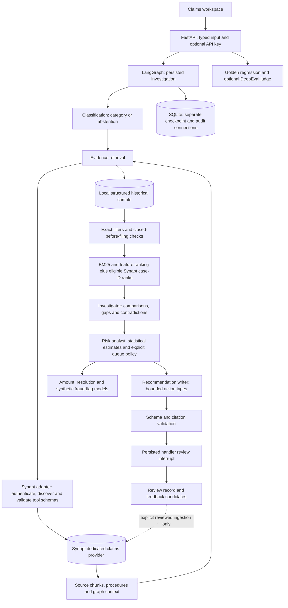

# Architecture and design

Synapt owns semantic retrieval and shared domain context. Local tabular history supplies numerical
comparisons, exact filters and model features. There is no separate vector database or embedding
pipeline in this application. Live hybrid fusion joins only stable claim IDs found in source-bearing
Synapt evidence to temporally eligible local rows. Fixture mode supplies explicit synthetic procedures
and has no real semantic search; a quality claim requires live validation.

## Data design

Claims inputs are validated separately from observed historical outcomes. The source dataset has
structured attributes, not incident narratives, policy documents or denial reasons. Generated claim
cards preserve that distinction and exclude fraud labels. Synthetic procedure/evidence documents
must be labeled and reviewed before ingestion. Real policies require insurer-controlled sources.

Model artifacts contain feature contracts, source SHA256, temporal partitions, calibration choices,
holdout metrics and global explanations. Amount prediction excludes the submitted amount from its
inputs. Resolution prediction uses closed claims and label-availability cutoffs. Fraud-flag estimates
predict the synthetic label; its observation time is unknown, limiting any prospective claim.

## Execution and interaction design

The interface exposes intake, comparison differences, citation navigation, predictions and review.
It separates customer service urgency from evidence investigation priority. Review accepts a brief,
never a claim outcome. Unsupported classifications and invalid citations block brief acceptance.
Revision requests are recorded; they do not silently regenerate or overwrite a reviewed brief.

Live generation uses focused role objectives and schema validation with bounded retries. The model
receives untrusted context as data and has no action tools. Recommendation action types are restricted
to evidence investigation. Citation membership is a mechanical check, not a guarantee of semantic
truth; source review and an optional judge provide additional evaluation.

Checkpoint transactions and audit transactions use separate SQLite connections with WAL, because
LangGraph checkpoints can run in a background executor. The service serializes investigation changes
for this local pilot. Multi-worker hosting requires a production persistence/identity design.

## Feedback and extension design

Reviewed feedback becomes candidate learning material. It never rewrites ground truth, trains a
model or updates Synapt automatically. The explicit MCP ingestion boundary supports a future reviewed
lesson corpus and procedure updates. Each promoted lesson needs its originating run, reviewer,
source evidence and an evaluation demonstrating benefit. The next implementation stage verifies
the real tenant contract before increasing providers, cases or agent autonomy.
