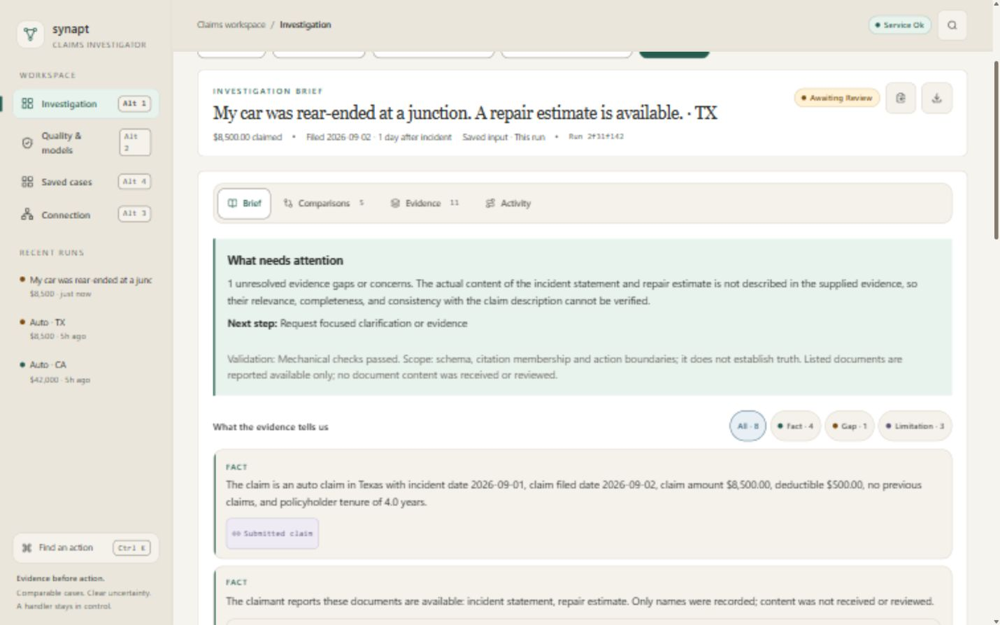
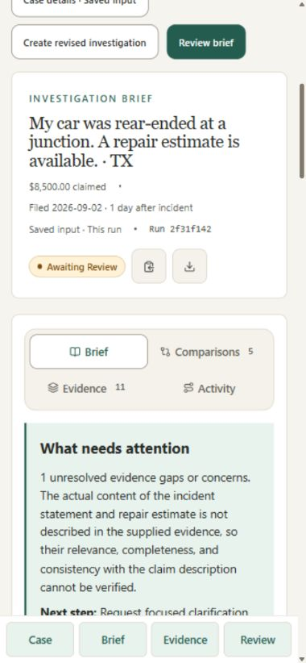
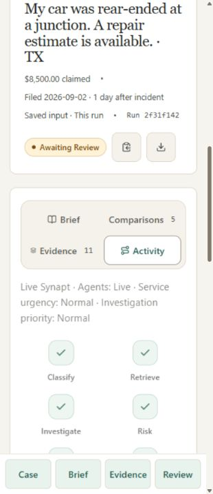
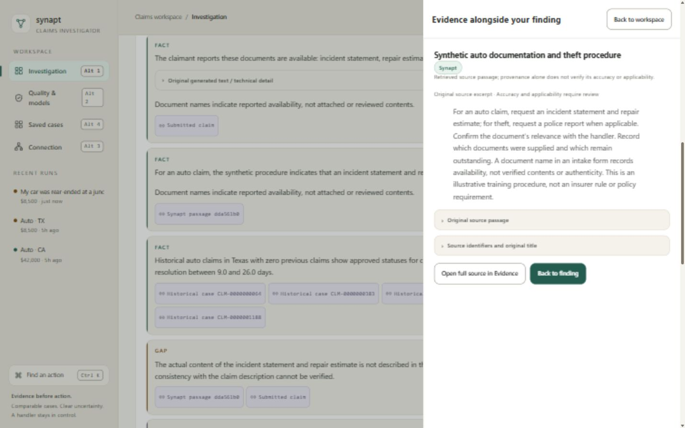

# UI/UX fixes — 6 October 2026

> **Historical record.** Written before the full-dataset work of 2026-10-06. Commands, test counts and conclusions here may be out of date. Current status: [VALIDATION.md](VALIDATION.md); Synapt: [SYNAPT_INTEGRATION.md](SYNAPT_INTEGRATION.md).

Implemented the ten prioritized findings, F1–F10, from `UI_UX_REVIEW_2026-10-06.md`. The application remains at http://127.0.0.1:8000/. This report separates implemented behavior from outstanding device, accessibility and user-study verification.

## Issue-by-issue result

| Finding | Root cause | Implemented fix | Completion evidence |
|---|---|---|---|
| **F1 — Empty column after collapsing intake** | Creation and reading used a permanent two-column grid. | Separate centered creation and full-width reading layouts. Read-only case details open in a native modal drawer; closing it reserves no column. | At a 1440px viewport, workspace and output both measured **1109.60px**. Drawer Escape closes it and restores focus. |
| **F2 — Examples and empty output dominate first use** | Demo cards and future results were permanently visible before input. | Incident → Details → Review composer; optional compact example disclosure; all-fields mode for expert entry. No empty result column. State names and codes share a searchable datalist; policyholder tenure has an explicit label. | Browser: empty Continue focused description with an inline error; demo advanced through all three steps; Texas normalized to TX; Back retained values. Isolated browser submission completed. |
| **F3 — UUID lookup cannot discover cases** | There was no saved-case index API, only eight browser-local shortcuts. | Added authenticated `GET /api/investigations` with deterministic word search, state names/codes, type, review status, filing dates, amounts, and pagination. Cards show incident-based titles, excerpt, amount, filing date and status. Exact-ID opening remains explicitly labeled. | Browser: rear-ended + Texas + Awaiting review found four existing cases; `Texas auto` found eight; the review's full UUID returned one; no-match search explained scope. Backend tests cover filters, pagination, restart persistence, literal `%`, injection-shaped text, input boundaries and API-key protection. |
| **F4 — Draft and result describe different claims** | Independent draft and saved-run states were displayed together. | Explicit draft/case modes; saved input snapshot identified by run ID; deliberate revised-investigation action; return to saved case and resume draft. Successful submission clears the completed draft. | Isolated browser: revised description changed while saved result stayed hidden; returning to saved case showed the original incident; Resume draft retained the revised text. Saved records were not rewritten. |
| **F5 — Process dashboard obscures findings** | Pipeline, four metrics and metadata preceded the answer. | Compact case header; “What needs attention,” unresolved concern count, next action and scoped validation first. Pipeline and urgency metadata moved to Activity. Comparisons use expandable summaries with amount/outcome/rank score. | Desktop screenshot shows identity, review state, concern and next step together. Browser confirmed five collapsed comparison summaries. |
| **F6 — Citation navigation disrupts reading** | Citation clicks switched tabs and forced a new reading location; passages had nested scrollbars. | Contextual evidence drawer; readable title and provenance; structured claim/comparison display; an unchanged narrative excerpt for other sources; original source and identifiers in disclosures; full-source and Back to finding actions. Passage scroll limits removed. | Citation → drawer → Escape restored the originating citation's focus without moving the page. Native modal contained focus. At 320px, evidence fit the document and had zero nested passage scroll containers; evidence search highlighted four matches for repair. Excerpt tests require the displayed text to be a literal substring of the original. |
| **F7 — Repeated implementation language** | Internal field keys, tool warnings and machine filenames appeared as primary text. | Readable field names and source titles, “No previous claims in either case,” grouped duplicate provenance notes, technical/original disclosures. Facts precede technical limitations, while the attention summary retains relevant concerns. | Browser showed the two provenance warnings as one limitation with two original notes. Unit tests verify field-name translations and preservation of original evidence. |
| **F8 — Names look like reviewed documents** | Model wording could describe reported availability as received content. | Explicit “Documents reported available” throughout intake and snapshots. Legacy generated assertions receive a qualified display with original generated text preserved. New-run validation rejects explicit unqualified received/reviewed-document assertions. | Frontend regression preserves the original object while showing names-only availability. Backend regression fails the misleading assertion and passes qualified availability wording; failed validation retains the existing human-review gate. |
| **F9 — Mobile fits but remains awkward** | Desktop tasks and navigation were compressed into narrow layouts. | One main task at a time; labeled global navigation; fixed Case / Brief / Evidence / Review controls with reserved space; full-screen mobile drawers; larger reading/control text and touch targets; two-column Activity stages at narrow widths. | At 390px and 320px, measured document widths were **380px** and **310px** (scrollbar excluded), with no document-wide horizontal scrolling in tested views. Four mobile primary targets measured **44px high**. All seven workflow labels stayed on a single line at 320px. |
| **F10 — Ambiguous search, transient errors, generic loading** | Search surfaces did not explain scope; opening errors only used a toast; pending state had no elapsed time. | Saved-case, action and current-case evidence scopes named distinctly. Lookup errors remain beside the field, retain the ID and selected result tab, and return focus. Pending investigations show elapsed time from a stable request timestamp and explain safe navigation, refresh limits and timeout recovery. | Unknown ID retained Evidence as the selected tab and focused `lookup-id`; previous case remained visible. Saved/evidence no-match states tested. Loading regression verifies no fabricated completed stages. Elapsed time is client time, not server progress. |

## Validation

| Check | Result | Scope |
|---|---|---|
| Production TypeScript/Vite build | Passed | Compiled frontend served by the existing Python application. |
| Frontend regression tests | **9 passed** | Stable values, validation states, honest loading, state normalization, names-only document display, readable labels and unchanged source excerpts. |
| Backend suite | **92 passed** | Includes the existing workflow/review suite plus saved-case search and document-availability validation regressions. Unit tests block external network calls. |
| Ruff | Passed on changed Python files | API, store, workflow and added tests. |
| Frontend lint | Completed with **14 warnings** | Component/shared-export Fast Refresh warnings and Quality/Connection effect warnings; no errors. These existing patterns were not broadly refactored as part of this UI task. |
| Browser interaction | Passed on tested flows | Composer, state conversion, Back, save/open/search, draft isolation/resume, comparison disclosures, keyboard tab switching, evidence search, drawer focus/Escape, review note validation and lookup recovery. |
| Contrast samples | **6.19:1–13.21:1** | Seven sampled text/background pairs, including primary action, selected navigation, selected chip, amber status, attention summary and finding text. Not an exhaustive contrast audit. |
| Responsive layout | Passed on tested states at **1440×900, 390×844, 320×740** | Simulated browser dimensions, not physical phones or actual browser zoom. |

The full create → review browser test used an **isolated fixture application on port 8001**, with fixture agents/retrieval and a separate database. Synthetic run `cf92f3c7-1abd-4b31-9e4c-5ed6d14c7122` was created and its brief review recorded there; this does not approve or pay a claim. No new live provider generation was required, and no existing case's review or feedback was changed. The temporary fixture server and browser tab were closed. Its script, database and logs remain under `artifacts/ui-fixes-*` for reproducibility. The original local application on port 8000 was restarted to load backend changes and remains running.

### Screenshots

Sample measurements: `ui-fixes-2026-10-06/contrast-samples.json`.

## Change transparency

### What I did

- Changed `frontend/src/App.tsx` to own separate draft/case modes, saved snapshots, draft resume, the case library, focused review, elapsed request timestamps and persistent lookup recovery.
- Changed `IntakeForm.tsx` to offer guided and all-fields entry, preserve structured validation, move examples into a disclosure and normalize named states.
- Added `CaseLibrary.tsx` for server-backed search/filter/pagination, and `Inspector.tsx` for native dialog focus containment, Escape and focus return.
- Changed `Results.tsx` for the compact header, attention summary, grouped limitations, contextual citations, mobile case navigation, expandable comparisons and Activity diagnostics.
- Updated `Sidebar.tsx`, `CommandPalette.tsx`, `lib/api.ts` and `index.css` for labeled scopes/navigation, timeout recovery, task-based layout, typography, touch targets, drawers and narrow-screen stages. Removed the original permanent grid and sticky intake scroll behavior rather than retaining it underneath a visual workaround.
- Added `lib/presentation.ts` for pure readable display transformations and literal excerpts; `lib/states.ts` consumes the shared `src/claims/core/us_states.json`. Enabled `resolveJsonModule` in the frontend TypeScript configuration so both API search and intake use the same state names.
- Changed `src/claims/storage/run_store.py` and `api/main.py` for bounded, parameterized saved-case search; changed `investigation/workflow.py` for the document-availability validation check.
- Added `tests/test_case_library.py` and extended `frontend/tests/ui-regressions.test.cjs`; rebuilt `src/claims/static/app/`; wrote this report, screenshots and isolated test artifacts.

### Why this approach

The product is a trust-sensitive investigation workspace with form-heavy creation and focused reading. Its existing warm ivory/green tokens, React components, validation and review controls are retained, with moderate density and one dominant task surface. The review supplied a precise design direction, so a new Stitch mockup was unnecessary. No runtime component library was added: React, existing CSS and native dialogs supply the needed behavior.

### Why not the alternative

A narrower intake pane would retain the wrong task boundary; more tabs alone would retain draft/result ambiguity. Relabeling UUID lookup would imply discovery that did not exist. Semantic search would add uncertainty and infrastructure before basic word/filter search works. A new panel framework would duplicate capabilities already available through native dialogs. Prompt instructions alone cannot guarantee that probabilistic document wording is correct, so an explicit validation check was added.

### What was the issue / root cause

Creation, reading, observability and review were structurally coupled. The app lacked server-side case discovery, and internal retrieval/display terminology made uncertain inputs look stronger than their actual evidence state. Each F1–F10 row above records the specific cause and resulting behavior.

### Why this works best

The implementation changes the task boundary and discovery contract while reusing the tested backend spine. Saved-case search has explicit deterministic scope; saved snapshots remain distinct from editable drafts; modal source inspection restores focus; model-derived wording remains qualified and review-gated. Source quotations and saved records remain inspectable in their original form.

### Other valid patterns

A guided-only wizard is simpler for occasional users but slower for complete expert input, so both modes are available. A pinned nonmodal evidence pane can suit larger screens but requires additional focus, sizing and mobile contracts; the current modal drawer is simpler and validated. A narrative extraction helper, document uploads, semantic discovery and voice can be considered separately after observed user tasks establish a benefit.

## Remaining limitations and optional follow-up

- Physical-phone, screen-reader, high-contrast, actual 200%/400% browser zoom and formative user testing remain outstanding. The checks above do not certify complete accessibility or user preference.
- Investigation execution remains a synchronous backend request: navigation within the open application is safe, but refreshing cannot resume an in-flight browser request. Cancellation/resumable background jobs require a separate backend execution contract; the UI states this rather than suggesting support that does not exist.
- Search covers the saved investigations in this server's database under its existing API-key boundary. It does not search historical corpora, external claim systems or other devices, and it does not introduce multi-user owner/tenant authorization. Empty search is ordered by original insertion, not a fabricated timestamp.
- The added document check catches explicit wording patterns; it is not general semantic truth validation. Historical saved validation results were not rewritten or retroactively revalidated. Their generated document assertions are qualified in the display and originals remain accessible.
- New uploads, narrative extraction, voice, editable server-side case titles, pin/resize frameworks and print/PDF exports were future ideas in the review, not observed F1–F10 defects. They were not bundled into this repair.
- No Git metadata was available at the workspace root, so no commit, push or Git-based diff comparison was performed.

### Conclusion

**What was done:** Implemented all ten prioritized UI findings and documented each fix with verification evidence.

**Process summary:** Reworked task boundaries, added deterministic saved-case discovery, preserved raw evidence and review gates, and validated with automated tests plus desktop/mobile browser flows.

**Outcome & next steps:** Build, 92 backend tests and nine frontend tests pass; use the updated local app and perform real-device/accessibility/user testing before making broader quality claims.
