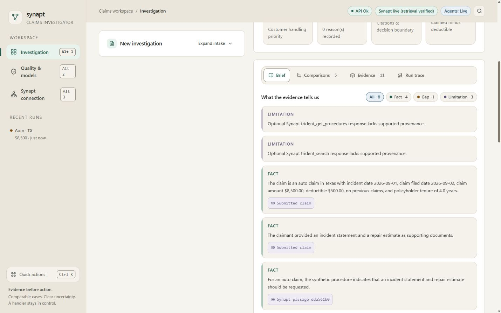
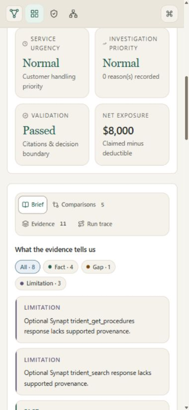
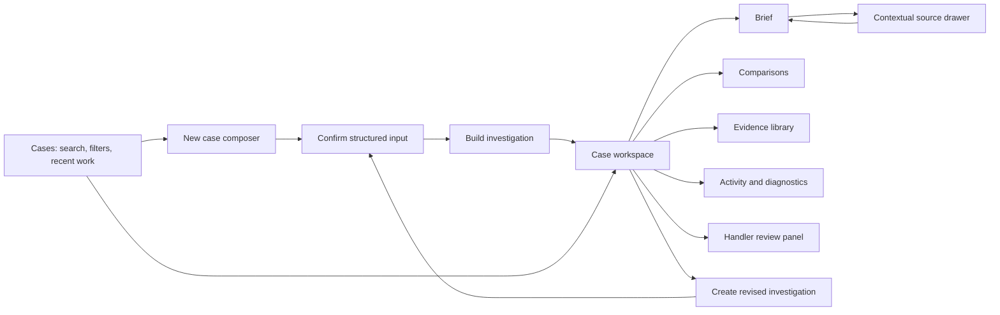

# Synapt Claims Investigator — UI, usability and workspace design review

> **Historical record.** Written before the full-dataset work of 2026-10-06. Commands, test counts and conclusions here may be out of date. Current status: [VALIDATION.md](VALIDATION.md); Synapt: [SYNAPT_INTEGRATION.md](SYNAPT_INTEGRATION.md).

**Reviewed:** 6 October 2026, Asia/Kolkata  
**Application:** http://localhost:8000/  
**Scope:** Current React UI, first use, intake, saved-case discovery, investigation results, evidence, keyboard interaction, responsive layout, and alternative product designs.  
**Method:** Direct browser use, screenshots, accessibility-tree inspection, selected DOM measurements, one synthetic live investigation, and targeted source inspection. This is an expert heuristic assessment, not a user study or accessibility certification.

## 1. Verdict

**The UI is visually coherent and promising, but it is not yet excellent across the full user experience.** I would describe it as a polished educational prototype whose visual styling is ahead of its workflow design. My subjective overall assessment is **6.5/10**, with visual appearance around **7.5/10** and everyday workflow efficiency around **5.5/10**. These are qualitative judgments, not measured satisfaction scores or a weighted benchmark.

The warm ivory surfaces, dark green primary actions, restrained icons and serif headings create a calm, credible personality. Preserve that foundation. The biggest improvement will come from deciding what the user is doing at each moment and giving that task the space it needs.

Your concerns are substantially supported by testing:

- **The intake is not the best default interaction in its current placement.** It is a long, narrow form with an independent scrollbar and large demo cards before the actual fields.
- **The saved-ID field is not meaningful case search.** It opens a known run identifier; it cannot discover a remembered incident by its description.
- **Too much remains visually coupled.** Creating a claim, reading results, understanding system diagnostics and recording review all compete within the investigation workspace.
- **Collapsing intake does not reclaim desktop width.** A mostly empty left column remains while the brief stays narrow.
- **Tabs already exist.** Brief, Comparisons, Evidence and Run trace are implemented. Adding more tabs without changing hierarchy would only partly address the problem.

**Recommended direction:** a searchable case library, a guided case composer, and a case-focused investigation workspace with one dominant reading area plus optional context drawers. Keep everything in the same application window; do not keep every task visible at once.

## 2. What was actually tested

The server initially refused connections. I restarted the existing Python application on **127.0.0.1:8000**, using the existing virtual environment and compiled frontend. No dependency reinstall or application rebuild was needed. The restarted server is intentionally left running as requested.

| Check | Observed result | Limit |
|---|---|---|
| Initial desktop screen, approximately 1270 × 714 | Coherent styling; large demo cards; intake plus empty-result split | Single browser environment |
| Desktop at 1440 × 900 | More reading width, but collapsed intake still reserves its column | Not an ultrawide test |
| Intake collapse/expand | Works; desktop grid does not expand output into released area | Layout issue, not a broken toggle |
| Built-in auto repair demo | Fields populated, submission disabled repeated input while busy, completed with live retrieval | One synthetic case; no real personal claim data entered |
| Result | Awaiting Review; 5 comparisons, 11 evidence entries, 8 findings in this run | Results may differ on future model runs |
| Brief / Comparisons / Evidence / Run trace | All inspected | Not every nested disclosure exhaustively exercised |
| Keyboard tab navigation | Right Arrow moved Comparisons to Evidence and focused the selected tab | Not a complete keyboard or screen-reader audit |
| Citation navigation | Clicking submitted-claim citation selected Evidence and focused its source article | Reading position changes rather than opening beside the finding |
| Evidence search | `repair` filtered/highlighted passages; `zzznomatch` produced an explicit empty state | Searches evidence in the current run |
| Quick actions search | `rear-ended` returned no matching actions despite that phrase being in the current saved claim | Confirms command search is not incident-content search |
| Unknown saved ID | Displayed “Investigation not found”; previous result remained available | Error uses a transient toast |
| Empty form submission | Blocked; focus moved to description; required/custom validation messages present | Date/amount boundary cases were inspected in code, not all exercised live |
| Quality & models | Readiness, model metrics, evaluation state and feedback rendered | Did not train models or rerun evaluations |
| Synapt connection | Readiness and service diagram rendered | No keys or settings changed |
| 390 × 844 phone viewport | No document-wide horizontal overflow in measured state; long vertical page; two-row result tabs | Simulated viewport, not a physical phone |
| 320 × 740 viewport | No document-wide horizontal overflow in measured state; awkward narrow-column word wrapping | Not equivalent to a complete zoom/reflow conformance test |
| Browser warning/error log | No entries returned at the end of this inspection | Not proof of zero network failures; deliberate unknown-ID request returned a handled error |

Synthetic test run: `2f31f142-721e-42a3-82b0-0d1a46b32a34`. It remains **awaiting review**. I did not accept the brief, request revision, save feedback, alter connection settings or delete records.

Screenshots:





## 3. Assessment by user-facing dimension

| Dimension | Assessment | Why |
|---|---|---|
| Beauty and brand personality | Good | Warm neutral palette and editorial headings feel deliberate and restrained |
| Consistency | Good | Cards, buttons, labels and status colors share a recognizable system |
| Visual hierarchy | Mixed | Headings work, but large status blocks and repeated cards compete with useful findings |
| Typography | Mixed | Headings are attractive; much of the operational text is only 12–13px |
| Space allocation | Weak | Intake occupies valuable width before and after it is needed |
| First-time understanding | Fair | Purpose and next steps are explained, but fields start below prominent demo cards |
| Data entry | Fair | Labeled inputs and validation are sound; the long narrow layout adds effort |
| Case discovery | Weak | UUID lookup and eight browser-local recents do not form a case library |
| Reading and investigation | Fair | Useful tabs, evidence links and filters exist; context switching and nested scrolling remain costly |
| Trust communication | Good foundation | Synthetic provenance, limited validation scope and human review are stated; technical language needs translation |
| Accessibility | Promising, incomplete verification | Labels, tab semantics, focus and keyboard behavior exist; conformance cannot be claimed |
| Mobile comfort | Fair to weak | Fits the viewport, but lengthy scrolling and icon-only navigation reduce ease |
| Loading and errors | Fair | Honest loading copy and useful errors; no observed elapsed time, cancellation or resumable progress |
| Expert efficiency | Fair | Shortcuts are useful, but case context and saved discovery are underdeveloped |
| Likely user appeal | Audience-dependent | Attractive for a capstone demo; repetitive professional use needs a more focused workflow |

Actual likability, speed and preference must be tested with users. A visually pleasing screen is not evidence that handlers will complete tasks accurately or enjoy repeated use.

## 4. Prioritized findings and root causes

### F1 — Collapsing intake does not produce a reading mode — High

**Evidence:** At both inspected desktop sizes, collapsing intake leaves the left column in place. The large blank area remains beside the results.

**Root cause:** `frontend/src/index.css:262` defines a fixed two-column workspace; the collapse state only hides intake content. The grid does not change with the workflow or collapse state.

**Recommendation:** Give reading the full content area. Expose “Case details” as a compact rail or drawer that can be opened when needed. If a desktop pane is pinned, reserve a bounded width only while open. A closed pane must return its space to the main content.

**Why not just make the panel narrower?** That improves one viewport while preserving the wrong task hierarchy. The underlying layout should respond to creation versus review.

**Acceptance:** Close details and the brief visibly expands; reopen it without losing values, scroll position or focus context.

### F2 — The first-use screen spends too much space on examples and an empty result — High

**Evidence:** At the initial desktop viewport, four substantial demo cards fill most of the visible intake; the description field is below them. The right pane is mostly onboarding copy.

**Root cause:** A form and a future result have equal structural permanence even though the user has not created a result yet.

**Recommendation:** Before a case exists, use a centered, comfortably wide composer. Make “Try an example” a compact secondary choice. After a successful run, switch to the case workspace.

**Alternative:** A three-step wizard is also reasonable for infrequent users. Keep an all-fields mode for experienced users who already have complete information.

### F3 — Exact-ID lookup is presented where users expect discovery — High

**Evidence:** The header says “Open a saved run ID.” The run ID is a UUID, not merely a number. Quick actions offers searchable commands, demo cases and recent labels, but an incident phrase does not find the current run.

**Root cause:** `App.tsx` calls `/api/investigations/{run_id}` directly. Recent entries have generic titles such as “Auto · TX.” `format.ts` retains eight recents in browser local storage. `CommandPalette.tsx:67` filters group, label and hint strings. The inspected API has exact run lookup, but no saved-investigation listing/search route. `/api/search` retrieves context for a supplied claim; it is not a saved-case search endpoint.

**Recommendation:** Build “Cases” with human-readable titles, recency, status and filters. Keep exact-ID opening as an advanced convenience. Do not relabel the existing field “Search cases” until it can actually search them.

**Acceptance:** “rear-ended,” “Texas auto,” a known ID and date/status filters can retrieve the intended saved case within the declared search scope. An empty query shows recents. No-match results explain what is searched and how to broaden it.

### F4 — Draft input and displayed results can describe different claims — High

**Evidence:** Clearing the intake left the previously generated result visible. Source inspection shows opening a saved run does not hydrate the intake from that run; loading a new demo changes input without clearing the existing result.

**Root cause:** Draft `form` and saved `run` are separate states displayed together without a strong case boundary. This is not proof of data corruption, but it creates ambiguity about which inputs produced the displayed brief.

**Recommendation:** Separate “New draft” from “Viewing saved case.” Display the saved input snapshot as read-only case details. “Create revised investigation” deliberately makes a new draft/version and labels prior results as belonging to the previous version.

**Acceptance:** Every result identifies its input version. Editing a draft never silently changes the apparent meaning of an old result; navigating cases cannot leak unsaved draft values into the viewed case.

### F5 — Results prioritize process metadata ahead of the user's answer — Medium-high

**Evidence:** A tall hero contains run metadata, a seven-stage workflow and four metric tiles before the result tabs and findings. At the ordinary desktop height the first result screen is mostly this summary.

**Root cause:** Engineering observability and the handler's reading task receive similar visual emphasis.

**Recommendation:** Lead with “What needs attention” and the strongest actionable summary, with the number of unresolved gaps. Keep a compact case header. Move execution stages into Activity/Diagnostics. Preserve warnings at the point where they affect interpretation.

**Acceptance:** On a normal laptop, the user can see the case identity, review state, main finding and next step without first scrolling past a process dashboard.

### F6 — Evidence is traceable, but reading it disrupts context — Medium-high

**Evidence:** A citation opens Evidence and scrolls to the source. Evidence passages have their own scrollbars, in addition to the page and desktop intake scrollbar. Some source headings are long machine-generated filenames, and raw identifiers appear prominently.

**Root cause:** The evidence library is both a raw technical viewer and the main explanation surface.

**Recommendation:** Open the cited passage in a contextual right drawer, keeping the selected finding visible. Show a human-readable source title, source type, verification status and highlighted excerpt first. Put identifiers and original raw content in a disclosure. Keep a full Evidence tab for searching and reading the collection.

**Acceptance:** Read a citation, close it, and return to the same finding and focus position. Provide “Open full source” and “Back to finding.” Never rewrite the original source text as if it were a verified quotation.

### F7 — Repeated technical caveats reduce scanability — Medium

**Evidence:** The first two findings in this run were “Optional Synapt trident_get_procedures response lacks supported provenance” and the equivalent `trident_search` warning. Comparison reasons include `previous_claims_count`; filenames and UUIDs appear in evidence.

**Root cause:** Internal names are exposed directly rather than translated into user meaning.

**Recommendation:** Say, for example, “Some retrieved material could not be linked to a source and was excluded,” with technical detail expandable. Say “No previous claims” instead of a field key. Keep important limitations prominent, but state their consequence rather than just the component that produced them.

**Acceptance:** A new user can explain what each warning changes about the brief without knowing Synapt tool names.

### F8 — Document names are easy to mistake for reviewed evidence — Medium-high

**Evidence:** Intake correctly states that it records names only. The generated result also states that actual document content cannot be verified, but one fact says the claimant “provided” the incident statement and repair estimate.

**Root cause:** Availability declarations and actual document content share an evidence-oriented vocabulary.

**Recommendation:** Use explicit states: “Reported available,” “Content attached,” “Extracted,” and “Reviewed.” Until uploads are implemented, say “Documents the claimant says are available.” A listed repair estimate should never acquire a visual “verified” status merely because its name was entered.

**Acceptance:** Users can distinguish a named document from content the system actually received and the reviewer actually checked.

### F9 — Responsive fit is better than responsive comfort — Medium

**Evidence:** At 390px the page fit horizontally, but navigation became icon-only, the brief tabs wrapped, and the expanded intake created a lengthy page. At 320px workflow labels broke across words. In one measured 390px state, collapsing intake reduced document height from roughly 7,318 to 5,268 CSS pixels; these are state-specific observations, not fixed product dimensions.

**Recommendation:** On mobile, show one workspace surface at a time. Use labeled Case / Brief / Evidence / Review navigation, full-screen detail sheets, compact summaries and a clear return path. Keep the primary action reachable without leaving it over the text being read.

**Acceptance:** No document-wide horizontal scrolling at narrow widths; no clipped focus; meaningful labels; readable single-column content. Test real phones and browser zoom separately.

### F10 — Search, errors and loading need clearer scope and recovery — Medium

**Evidence:** There are three different search-like surfaces: run-ID lookup, Quick actions and evidence search. Unknown ID creates a toast. The investigation loading state is honest but generic.

**Recommendation:** Name scope explicitly: “Search saved cases,” “Find an action,” and “Search this case's evidence.” Keep lookup errors next to the field with an example or recent-case link. For long runs, show elapsed time and a safe way to leave and return; only show stage progress if the backend supplies it.

**Acceptance:** Users know what each search searches, retain input after errors, and can tell the difference between still running, failed and completed. Do not fabricate progress percentages.

## 5. Is another input method better?

**Yes: improve the interaction model, while retaining structured fields as the source of truth.** Replacing the form with a chatbot alone would make dates, amounts and missing fields harder to audit.

| Input pattern | Best use | Trade-off | Recommendation |
|---|---|---|---|
| Current all-fields form | Experienced users with complete data | Fast direct access, but overwhelming in a narrow pane | Retain as an optional compact expert mode |
| Guided composer: Incident → Details → Review | First use and occasional handlers | Adds navigation, but gives clear completion and correction | Best immediate default |
| Narrative plus editable field preview | Copying an incident account | Extraction can be wrong or incomplete | Best later enhancement with explicit confirmation |
| Document-led intake | Claim packet already exists | Requires actual upload, parsing, provenance and failure UX | Valuable future work; current names-only form cannot support it |
| Conversational assistant | Asking focused clarifying questions | Slow for known structured values; difficult to scan chat history | Optional helper, not the only input route |
| Voice dictation | Hands-busy initial description | Noise, privacy and transcription errors | Optional description aid with editable transcript; no automatic submission |
| CSV / case-system import | Repeated operational intake | Mapping, duplicates and permissions add complexity | Later, only if real user volume justifies it |

### Recommended composer

1. **Describe the incident.** A wide text area, an optional “Try an example,” and concise guidance. Ask for a case title, or propose an editable neutral title from confirmed details.
2. **Confirm the details.** Group fields into Event, Financial details and History. Use a searchable state selector that accepts names and codes. Explain “Policyholder tenure” instead of “Tenure.” Keep claim type override available.
3. **Review the input.** A compact summary of confirmed values and declared document availability, with direct Edit links and the final “Build investigation” action.

Avoid making every individual field its own step. Preserve entered values on Back. Offer “Show all fields” for experienced users. Display required versus optional fields before submission. Save drafts with an explicit retention policy; do not silently persist sensitive claims in browser storage.

### Narrative extraction, if added

Use a side-by-side narrative and editable details preview. Mark extracted values as suggestions and attach the exact supporting text span. Keep unknown values blank; do not turn missing amounts or dates into guessed defaults. Validate schema, types, ranges and date relationships. If extraction fails, keep the original narrative and allow manual entry. Conflicting values should be shown for review, not silently resolved.

“Extract details” and “Build investigation” must be separate actions. Any voice or document route should converge on the same validated review screen. Log extraction and user confirmation with appropriate access and retention controls, excluding secrets. LLM suggestions do not become action authority.

## 6. What should users search for?

Search should reflect a task, not simply expose a database identifier.

### A. Find a saved case — global case library

Search human-readable titles and incident descriptions, plus exact case/run IDs. Combine with explicit filters for type, state, filing date, amount range and review status. Examples:

- `rear-ended` → title and incident description matches.
- `Auto` + state `Texas` + status `Awaiting review` → filtered case list.
- A pasted UUID → exact saved investigation.
- Amount `$8,500` as a structured amount filter rather than an unexplained bare number.

Each result should show title, type, state, amount, relevant date, review status and a short matched excerpt. The ID remains secondary. Start with deterministic text search and filters; semantic search is optional if testing demonstrates added value. Do not advertise natural-language filters until their interpretation is implemented and displayed back to the user.

The backend needs listing/search, pagination and stable metadata. A future multi-user version also needs authorized search results scoped by owner/tenant. Do not assume the eight browser-local recents are a complete list of saved cases.

### B. Find evidence — within the current case

Search source titles and passages, with source-type filters and highlighted matches. Examples: `repair estimate`, `filing date`, `police report`. Label this “Search this case's evidence.” The existing evidence search is a useful base.

### C. Find an action — command palette

Keep Ctrl+K for navigation and commands such as New investigation, Open Cases, Show Evidence and Copy case ID. The current palette already provides a useful foundation. It can include a clearly separated Cases result group once real case search exists; group labels must make the difference obvious.

### D. Find comparable historical cases — dedicated comparison controls

Expose claim type, state and amount filters within Comparisons, with the active criteria visible. Historical records are not the same objects as saved investigations. Keep those indexes and result labels distinct.

## 7. Creative layout directions, with trade-offs

### Option A — Case workspace with contextual drawers — Recommended

```text
┌──────────────────────────────────────────────────────────────────────────┐
│ Synapt   Cases / Rear-end collision · TX      Search cases     New case   │
├────────────┬───────────────────────────────────────────┬─────────────────┤
│ Cases      │ $8,500 · Awaiting review · Input v1       │ Evidence        │
│            │ Brief   Comparisons   Evidence   Activity │ inspector       │
│ Recent     ├───────────────────────────────────────────┤                 │
│ • Rear-end │ What needs attention                     │ Selected source │
│ • Theft    │ Document contents need verification      │ Highlighted     │
│            │                                           │ passage         │
│ Details ›  │ Findings with inline citations           │ Provenance      │
│            │ Recommended next steps                   │ Open full source│
├────────────┴───────────────────────────────────────────┴─────────────────┤
│ Review brief…    (opens review panel; never approves the claim)          │
└──────────────────────────────────────────────────────────────────────────┘
```

The right inspector is closed by default and opens from a citation. “Details” is a separate read-only pane; do not keep every drawer open together. At typical laptop widths, opening one secondary pane should close or overlay the other. Offer explicit pin/unpin for wider displays. A collapsed global sidebar becomes a narrow labeled/tooltip rail and actually returns width.

**Why this is best here:** It supports the core loop—read a finding, inspect its evidence, return to the finding—without mixing it with new-claim entry. It preserves the current visual identity and much of the existing result implementation.

**Trade-off:** Panel focus, Escape behavior, resize limits, scroll restoration and mobile transformations need deliberate engineering.

### Option B — Guided investigation stages

```text
Create case → Confirm details → Investigate → Review brief
                    one main task surface at a time
```

Best for demonstrations and novice users. Make completed steps revisitable without destroying data. The drawback is slower back-and-forth work for experts; offer a summary rail and direct Edit links rather than forcing a full wizard replay.

### Option C — Evidence notebook

A central readable brief with numbered findings and a collapsible outline on the left. Selecting a citation opens a margin annotation on the right. Findings can be filtered by Facts, Gaps and Limitations. This is a strong alternative if reading and source checking dominate user work. It needs a separate comparison surface and careful mobile treatment.

### Option D — Comparison workbench

Pin the current case beside one or two historical cases and align rows for amount, state, filing delay and supporting details. Highlight meaningful differences with text, not color alone. Prefer this as a mode inside Comparisons, not the default home screen. It is useful for experts but too dense for intake and small screens.

### Option E — Investigation board or timeline

Organize evidence into Known / Missing / Conflicting, or show incident, filing and evidence-arrival events on a timeline. This can be useful for complex chronology. It should remain an optional alternate view with a list equivalent. A free-form canvas with draggable cards would look creative but create unnecessary navigation and accessibility work for simple cases.

**Do not combine all five designs.** Use Option A as the main architecture, Option B for creation, and a small part of Option D for detailed comparison. Consider the notebook or timeline only when actual user tasks justify them.

## 8. Proposed navigation and state model



Keep Cases and New case prominent. Put Quality & models and Connection under an Administration or System section, still easily accessible for the capstone evaluator. A case should have a stable URL, clear selected state, and browser Back behavior. Persist selected tab and scroll appropriately; drafts and saved runs must have separate identities.

Opening a drawer must not submit, rerun or change a case. Editing a saved case should create an explicitly labeled draft revision. Closing a pane must preserve work. When leaving an unsaved draft, provide a clear save/discard decision or a documented autosave behavior.

## 9. Visual refinement brief

- **Preserve:** ivory background, green accent, readable dark text, serif page/case titles, restrained line icons, explicit evidence provenance and human-review boundaries.
- **Reduce:** stacked decorative cards, large process summaries, repeated identity labels, generic empty output space and prominent machine identifiers.
- **Increase:** main reading width and body-text comfort. Aim for roughly 15–16px narrative text, sensible line length and clear paragraph spacing; use smaller metadata sparingly.
- **Differentiate:** factual findings, missing evidence, limitations and review actions through wording and hierarchy as well as color. “Validation passed” should state which checks passed nearby.
- **Improve titles:** “Rear-end collision — Texas” is more recognizable than “Auto · TX” when several cases have the same type and state. Let users edit the proposed title.
- **Simplify the header:** one compact service state, detailed status on demand. Avoid repeating the same technical status in header, banner and case hero at equal prominence.
- **Make comparisons scan-friendly:** translate internal keys, explain score meaning beside it, and use aligned rows or selectable comparison cards instead of five lengthy expanded records.
- **Improve export:** retain JSON for technical use; consider a readable print/PDF brief with citations and limitations for handlers. Current review did not test export.
- **Use motion sparingly:** short panel and selection transitions can orient the user; never animate factual amounts or imply progress the server has not reported.

## 10. Accessibility and implementation constraints

Observed strengths include the skip link, labeled controls, radio groups, result-tab semantics, visible focus styling, keyboard tab switching, and focus movement to results and selected evidence. CSS includes reduced-motion handling, but its live behavior was not tested.

Full contrast measurements, target-size measurements, screen-reader testing, 200%/400% zoom, high-contrast mode and physical touch testing remain outstanding. The restrained palette should not be described as inaccessible merely because it is muted, and the absence of horizontal overflow does not establish full accessibility.

For implementation, use WCAG's text contrast thresholds—normally 4.5:1, or 3:1 for qualifying large text—and test actual foreground/background pairs, including interaction states. [W3C contrast guidance](https://www.w3.org/WAI/WCAG22/Understanding/contrast-minimum.html)

Ensure pointer targets meet the 24 × 24 CSS-pixel minimum or an applicable exception; prefer comfortably larger targets for primary touch actions. Do not mistake a recommended 44px touch target for the universal AA minimum. [W3C target-size guidance](https://www.w3.org/WAI/WCAG22/Understanding/target-size-minimum.html)

Test narrow reflow at 320 CSS pixels and zoom separately. Dense comparison tables may need their own horizontal scrolling, but that should not force the entire document to scroll horizontally. [W3C reflow guidance](https://www.w3.org/WAI/WCAG21/Understanding/reflow)

Drawers need sensible initial focus, Escape to close, focus return, accessible names and a reading order consistent with the visual order. Modal overlays should trap focus; pinned nonmodal panels should not. A draggable splitter also needs keyboard controls or preset widths. Sticky controls must not hide focused elements.

Progressive disclosure should hide secondary detail while keeping the main task apparent; it is not an excuse to hide required information. [Nielsen Norman Group: Progressive Disclosure](https://www.nngroup.com/articles/progressive-disclosure/)

Human-readable case lists reduce the need to remember opaque IDs, consistent with recognition over recall. [Nielsen Norman Group: Recognition and Recall](https://www.nngroup.com/articles/recognition-and-recall/)

## 11. Recommended implementation sequence

| Order | Work | Completion evidence |
|---|---|---|
| 1 | Separate new-draft and saved-case modes; reclaim width on collapse; compact case header | No ambiguous draft/result pair; before/after screenshots at laptop and mobile widths |
| 2 | Create guided composer and expert form mode; move examples into a secondary picker | Complete manual intake without hunting through nested scroll areas; values preserved on Back |
| 3 | Add real saved-case library and deterministic search/filter endpoint | Incident phrase, ID, status and date tests; recents are visibly labeled as recents |
| 4 | Add contextual evidence inspector and focused review panel | Citation → source → return works with mouse and keyboard; focus and scroll restored |
| 5 | Refine typography, terminology, mobile navigation and error recovery | Measured accessibility checks and representative device testing |
| 6 | Add narrative extraction only if it improves observed intake tasks | Incorrect/missing/contradictory model output remains editable and cannot submit silently |

Do not implement a full multi-pane framework, semantic search, uploads and voice simultaneously. They have different dependencies and failure modes. The first four steps address the observed problems directly.

## 12. Validation plan for user appeal

Recruit a small formative group representing novice evaluators and experienced claim reviewers, then compare the current layout with the proposed workspace. A small sample can reveal usability problems; it cannot prove population-wide preference.

Give each participant the same tasks: create a case from a short narrative, correct an amount, find a previously saved rear-end incident, locate an evidence gap, inspect its source, compare one historical case, and explain what accepting a brief does. Include phone use where it reflects real usage.

Record task completion, input errors, time to first useful finding, wrong-case selection, backtracking, failed searches, and whether users confuse document names with verified contents or validation with truth. Collect brief ease-of-use ratings and ask which view they prefer and why. Set improvement targets after measuring the baseline rather than inventing a percentage gain now.

A successful redesign should make case discovery possible without memorized IDs, preserve context during source checks, make uncertain information obvious, and reduce unnecessary scrolling while maintaining review controls. Beauty should support those outcomes.

## 13. Change transparency and limitations

### What I did

Created this report and two screenshot evidence files under `docs/ui-review-2026-10-06/`. Restarted the existing local server, producing `artifacts/ui-review-server.stdout.log` and `artifacts/ui-review-server.stderr.log`. Created one synthetic investigation through the UI. Application source and configuration were not edited.

### Why this approach

Browser testing establishes what users actually see; targeted source inspection explains layout and search behavior. The report separates observations, implementation facts, design judgments and future recommendations.

### Why not the alternative

A screenshot-only opinion would miss search scope, keyboard behavior and draft/result ambiguity. An unsolicited redesign would skip the requested assessment and make the recommendation harder to evaluate independently.

### What was the issue / root cause

The current architecture gives intake and output permanent shared space, while case creation and case reading need different layouts. Identifier-based reopening and shallow local recents are being asked to fill the role of case discovery.

### Why this works best

The proposed separation fixes the workflow boundary while reusing useful tabs, validation, source links and visual tokens. It avoids a cosmetic layer over the same structural problems.

### Other valid patterns

A wizard is appropriate for occasional users; an evidence notebook suits intensive reading; a comparison workbench suits expert analysis. The recommended combination prioritizes the observed tasks and keeps alternatives optional.

This review does not certify production readiness, model accuracy, insurance correctness, privacy compliance or universal user preference. No comprehensive automated test suite was run because no application code changed. The single successful live demo demonstrates the tested path only. The original cause of the stopped server was not diagnosed. No Git metadata was present at this workspace root, so repository diff/commit checks were unavailable.

## Conclusion

**What was done:** Reviewed the running application and documented visual, interaction, input, search and layout findings with screenshot evidence.  
**Process summary:** Used direct browser testing, one synthetic live case, responsive and keyboard checks, targeted code inspection and published usability/accessibility guidance.  
**Outcome & next steps:** Keep the current visual identity, but prioritize a guided composer, searchable case library and focused case workspace with contextual evidence; validate the redesign with users before calling it excellent.
