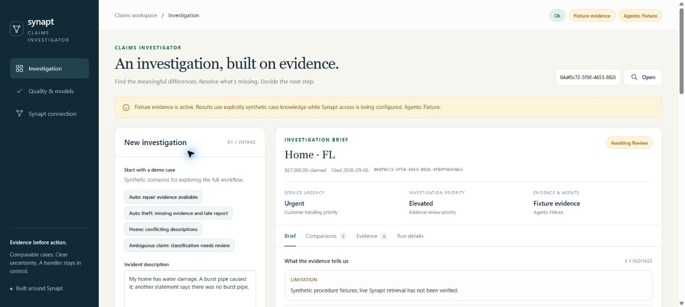
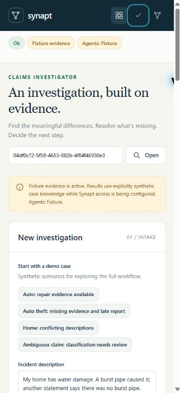

# Validation record — 2026-10-05

This initial fixture baseline describes the implementation tested on the local Windows workstation.
Subsequent live NVIDIA verification is recorded in [LIVE_NIM_VALIDATION.md](LIVE_NIM_VALIDATION.md).
Live Synapt service configuration remains unverified.

## Executed checks

| Check | Actual result |
|---|---|
| Python regression suite | **63 passed in 8.48 seconds** using Python 3.12.14 and the evaluation extra |
| Ruff source/tests/scripts | All checks passed; formatting applied |
| Optional evaluator dependency | DeepEval 4.2.8 installed; LLMTestCase, SingleTurnParams, base model and all three metrics imported successfully |
| Model-judge inference | Not run: model/key missing; UI correctly reports unavailable rather than passed |
| Browser golden evaluation | Four of four golden scenarios passed in fixture mode; separate judge unavailable status |
| Adapter contracts | 31 tests: provider scopes, discovered schemas, source normalization, safe failures, read retries and explicit single-attempt writes |
| Persistence | Restart/resume and duplicate-review tests pass; twenty repeated checkpoint/audit/review cycles pass with independent connections |
| Historical retrieval | Exact filters, no-match behavior, outcome availability and semantic case-ID fusion tests pass |
| Live generation contract | Mocked malformed JSON retries, invalid schemas, no fallback and untrusted-context instructions tested |
| Review boundaries | Forged sources, disallowed actions/reasons and ambiguous classifications block brief acceptance |
| Statistical pipeline | Ten focused model/download tests; actual published synthetic sample trained and holdout metrics measured |
| Ingestion preparation | Ten eligible cards generated locally, source SHA verified, fraud labels excluded; no upload occurred |
| Python distribution | Source archive and wheel built; frontend included; private environment, raw data and artifacts excluded |

## Browser evidence

The real browser opened the local FastAPI app and exercised intake, comparison results, citation
navigation, saved-run lookup, acceptance and feedback. Accepted runs disabled repeat review.
The ambiguous scenario displayed unavailable category-dependent predictions and blocked acceptance.
Missing run lookup showed “Investigation not found” and recovered after opening a valid run.
The final home-conflict run showed urgent service handling and elevated evidence investigation.

At the default desktop width of 1526 pixels, document width was 1511 pixels. At a 390×844 mobile
viewport, document width was 375 pixels; no horizontal overflow was observed. Mobile navigation
retained accessible names, keyboard Tab moved to the next named control with a visible focus outline,
and new run IDs cleared the previous claim's review/feedback drafts. Same-run refresh preserved drafts.
Browser logs contained no captured application errors/warnings at the inspected point. This is focused
interaction verification, not a full accessibility certification or cross-browser device matrix.

## Actual sampled-model results

Source: ZiadataLabs FreeInsuranceClaims100M, 3,000 original synthetic rows, bounded contiguous slice.
SHA256: `942e2498947baa786a62b5a317708a02c7fffb65a51e2053ad241d6127886e5f`.

| Task | Holdout | Baseline | Limitation |
|---|---:|---:|---|
| Submitted claim amount | MAE $16,906.97 | MAE $23,567.14 | High error; not settlement/coverage prediction |
| Resolution duration | MAE 6.49 days | MAE 7.19 days | Resolved claims only; censoring not modeled |
| Synthetic fraud-flag ranking | Average precision 0.2717 | 0.0867 | Synthetic label, observation timestamps unknown |
| Synthetic fraud-flag decision threshold | Precision 28.1%, recall 30.8% | — | Weak signal; not fraud proof or an adverse decision |

Amount intervals covered 85.7% of the holdout at a nominal 90% calibration level; resolution intervals
covered 90.8%. Calibration-selected thresholds/explanations are not independently calibrated quality
claims. See MODEL_CARD.md for temporal partitions, feature exclusions and global explanation details.

## Integration review and remaining gates

Read-only independent review reproduced three defects, all fixed with regressions: negative-only
burst-pipe statements generated false contradictions; unsafe recommendation reasons bypassed action
validation; and evaluation ignored recommendation citations/expected validation outcomes. A separate
transaction-ownership fix prevents background checkpoints from sharing audit transaction state.

The actual Synapt console exposed the 17 trident tools and an existing hands-on provider. That read-only
inspection did not verify programmatic authentication, a dedicated claims provider, write access,
ingestion completion, live retrieval fidelity or graph/procedure schema behavior. Adapter tests use
mocked contracts; discrepancies with the tenant must be resolved through discovery.

Live gates remain: credentials/provider permission, ten-card ingestion, extraction/provenance checks,
known-query retrieval, exact-filter/tenant isolation, agents/judges on live Synapt evidence, independently labeled
retrieval relevance, cost/latency measurement and domain review. The optional API key is local access
protection, not multi-user identity. Public hosting and real insurance use are outside this validated
local configuration. Temporary browser testing tabs and server processes were closed after validation.
